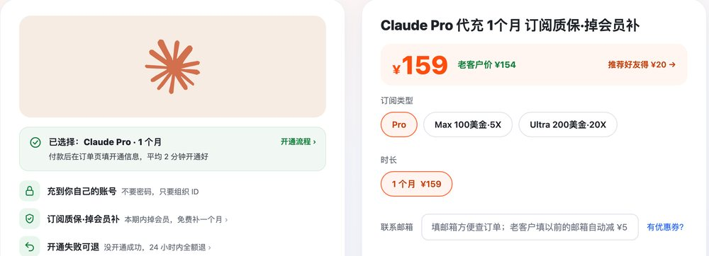
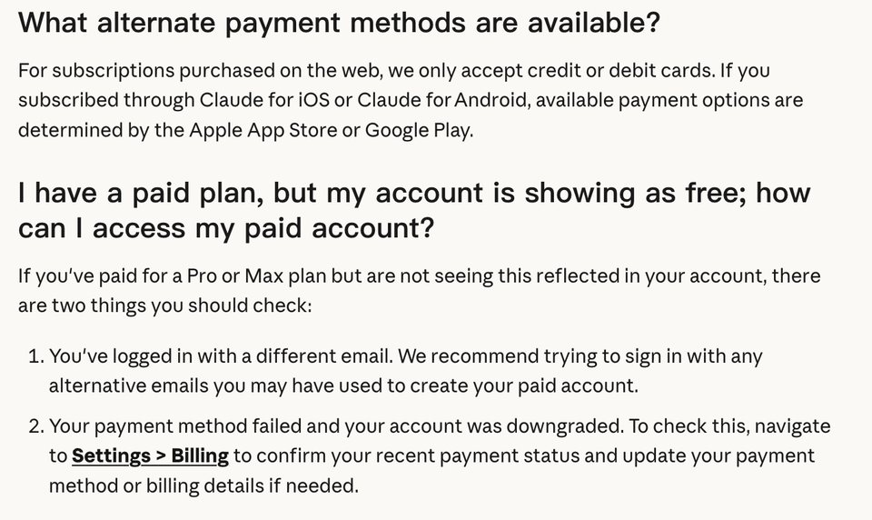
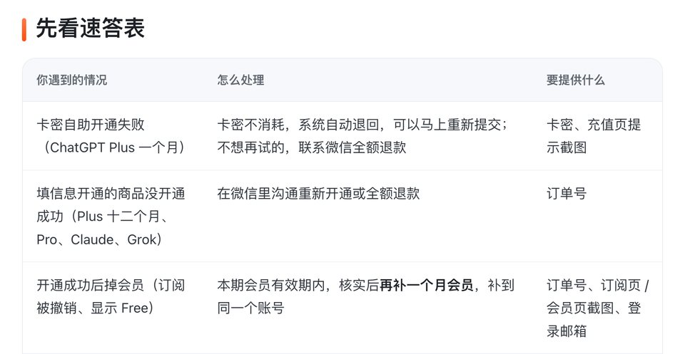

# Claude代充 / Claude充值 2026：全流程、Free 排查与避坑

> 2026-11-05 更新 · 瑶瑶ai训练师（kw.yaoyao.chat 店主）整理 · 文中商城链接为广告

**先说结论：** 想给自己的 Claude 账号开会员，在瑶瑶ai训练师的商城下 [Claude代充 Pro ¥159](https://kw.yaoyao.chat/item/12?utm_source=github&utm_medium=readme&utm_campaign=claude-chongzhi&utm_content=top) 就行：付完款在订单页填组织 ID，平均 2 分钟到账，密码、验证码、证件照都不用给；没开成重开或退款，本期内掉会员补一个月。下单填券码 **888888** 再减 ¥3。

- **是什么**：卖家替你交会员费，Pro、Max 或 Ultra 开在你自己的账号里，对话和项目都不动。
- **多少钱**：一个月 Pro ¥159、Max ¥900、Ultra（原 Max 20x）¥1,800，同一个下单页选档。
- **靠不靠谱**：店主从 2023 年 10 月起讲 AI 科普，各平台粉丝合计约 320 万；据 2026-11-05 的商城页，近 30 天全站开通 491 单，累计 618 单。
- **谁不用买**：有能付外币的卡或外区商店账号的，自己升级就行；要充 API 余额的，也不是这个；号上已有 Pro、Max 或 Ultra 的，店里不能覆盖充值，换个非会员的号再开。
- **顺手开 ChatGPT**：这家店销量第一的其实是 [ChatGPT Plus 充值一个月 ¥129](https://kw.yaoyao.chat/item/5?utm_source=github&utm_medium=readme&utm_campaign=claude-chongzhi&utm_content=plus-top)，同样只在订单页填信息、不用给密码，结账也能填 888888。

*图：瑶瑶ai训练师商城选 Pro 时的下单区，左边写着付款后在订单页填开通信息；第三个按钮上的「20X」是改名前的旧称，指的就是 Ultra 这一档（kw.yaoyao.chat/item/12?d=pro，2026-11-05 截图）*

## Claude代充是怎么回事：钱谁付、开在哪

在 claude.ai 网页上升级会员，Anthropic 只收信用卡和借记卡；在 iPhone 或安卓 App 里升级，钱由 App Store、Google Play 收，能用什么付款也是应用商店说了算。手里没有能付外币的卡、也没有外区商店账号，就只能找人代付，这就是"Claude代充"。

*图：Anthropic 帮助中心账单 FAQ 截图，上半是网页只收信用卡、借记卡，下半是显示 Free 的两个原因（support.claude.com，2026-10-30 截图，11-05 复查原文没变）*

说白了就是：你付人民币给卖家，卖家走他那边的渠道交掉会员费，会员开到你提交的账号上。卖家全程不碰你的登录，开出来跟自己付费开的会员没两样。

这样开的会员，有三点心里要有数：

- 账号还是你的。对话、项目、Claude Code 的登录都在原处，额度规则也跟自己付费一样。
- 付款记录不在你名下。有问题只能按卖家写的售后规则办，Anthropic 那边退不了款。
- 不会自动扣费。会员不绑你的卡，到期回到免费版，记录都保留；想接着用，再下一单开到同一个账号。

搜"claude 代充"的时候，还会撞见两类东西，它们都不是开在你账号上的代充：

| 你看到的 | 实际是什么 | 麻烦在哪 |
|---|---|---|
| 成品号、共享号、拼车 Max | 卖家注册的账号借给你用 | 邮箱和找回权在别人手里；几个人在不同地方登录，容易被停用 |
| 镜像站、套壳网站 | 第三方网站转接模型 | 进不了 claude.ai 和 Claude Code；模型、额度网站定，对话存在别人服务器上 |

## 组织 ID 在哪看，为什么只要它

Claude 的会员认的是账号背后的"组织"，不是登录邮箱。Anthropic 帮助中心讲账号受限时，也是一个组织一个组织地列。说白了，卖家要组织 ID，就是为了确认会员该落到哪个账号、开哪一档。

找组织 ID（界面以你看到的 Claude 版本为准，订单页也有截图）：

1. 先登录你日常在用的那个 Claude 账号。
2. 左下角头像 → 设置（Settings）→ 账号（Account）。
3. 页面里有一行 Organization ID，是一串带横线的字母数字（UUID 格式，帮助中心的企业版说明里也是这个位置），复制下来。

组织 ID 只是个编号。别人拿着它，登录不了你的账号，也看不到你的对话。真正要守住的是：账号密码、邮箱或手机验证码、浏览器里的登录 Cookie、证件照片。哪家开 Claude 问你要其中任何一样，换一家。

提交前多看一眼，ID 是不是从常用账号里复制的。有好几个邮箱、进过团队空间的人，最容易复制错。

## 从下单到到账：4 步，平均 2 分钟

1. **准备账号**：账号能正常登录，页面上没有没处理完的验证或警告，而且眼下还是免费版，不是 Pro、Max 或 Ultra 会员。还没账号的，先去 claude.ai 注册好。
2. **下单付款**：在下单页选好档位，人民币付款，付款方式以下单页显示为准。
3. **填组织 ID**：付完款就在订单页填组织 ID 提交，不用先加企业微信。
4. **等到账，再核对**：平均 2 分钟到账，这期间别重复下单。到账后网页端登出再登入，从头像菜单里看套餐名有没有变成 Pro、Max 或 Ultra；手机 App 也登出重登一次。

档位就说一句：头一回买就开 Pro，跑一个月看看会不会老碰上限；每天都开着 Claude Code、Pro 常在 5 小时窗口里见底的，再换 [Claude Max代充（¥900）](https://kw.yaoyao.chat/item/12?d=max5x&utm_source=github&utm_medium=readme&utm_campaign=claude-chongzhi&utm_content=mid)；同一个下单页还有 Ultra（¥1,800）。官方定价页现在的说法是：Max 不论按 5 小时还是按周算，都是 Pro 的 5 倍；Ultra 按周算是 Pro 的 10 倍，账号通过认证后不设 5 小时上限。要是 Pro 还在用着、半路就想换 Max，这个号店里加不上去，得拿一个不是会员的号另开。

## Claude充值后还显示 Free plan：按顺序查 5 处

付了钱还是 Free，先别慌。Anthropic 账单 FAQ 只给了两个原因：登录的邮箱不是开会员的那个；付款失败，账号被降了级。代充不走你的卡，第二条基本碰不到，重点查账号本身：

| 第几步 | 查哪里 | 发现问题怎么办 |
|---|---|---|
| 1 | 页面或 App 还是旧状态 | 网页登出再登入；App 里登出重登，或者先升级 App |
| 2 | 当前登录的邮箱 | 设置里看邮箱，对一下是不是复制组织 ID 的那个账号；Google 账号登录和邮箱直接登录，邮箱不一样就是两个号 |
| 3 | 用 Apple 登录时选了隐藏邮箱 | 账号邮箱是 Apple 给的转发地址，结尾是 privaterelay.appleid.com；换到电脑上也得选 Apple 登录 |
| 4 | 当前停在团队（Team）空间 | 从账户菜单切换到个人账户 |
| 5 | 钱交到了 platform.claude.com（原 console.anthropic.com） | 那是开发者平台的 API 余额，按用量扣，跟会员不是一本账，也不能互转 |

想确认会员真的到了，看四处：

- **设置 → 账单（Billing）**：套餐一栏写的是 Pro plan、Max plan 或 Ultra plan。
- **设置 → 用量（Usage）**：帮助中心写明，付费套餐能在这里看到进度条，一条是 5 小时会话、一条是每周上限，旁边标着重置时间。买的是 Ultra、只看到每周那一条，不是没开好：官方说认证过的 Ultra 账号本来就没有 5 小时那条。
- **模型列表**：对话框的模型下拉里能选 Opus 了。官方定价页写明免费版用不了 Opus。
- **Claude Code**：终端里输入 `/status`，看登录的是不是你的 Claude 账号；不是就输入 `/login`，换成 Claude 账号登录。系统环境变量里有 `ANTHROPIC_API_KEY` 的，官方说 Claude Code 会先用这个 Key、按 API 收费，用不上就删掉，重开终端。

会员开好以后，偶尔会跳出英文提示。下面三条讲的是额度和服务器，跟会员开没开成无关：

| 看到的提示 | 意思 | 怎么办 |
|---|---|---|
| `5-hour limit reached - resets [时间]` | 这 5 小时的额度用完了（认证过的 Ultra 账号不会出这条） | 等到提示里的时间；老是撞上就考虑升一档 |
| `You've reached your weekly limit` | 本周上限用完了 | 提示后半句写着哪天几点重置 |
| `Due to unexpected capacity constraints…` | 官方说这不是故障，是全站同时用的人太多 | 隔几分钟再发 |

买的是 Max 或 Ultra、显示的却是 Pro，也是先登出重登、核对邮箱。几步都做完还不对，把登录邮箱和订单号发到瑶瑶ai训练师的企业微信（`kw.yaoyao.chat/wecom`），全天 24 小时，只认瑶瑶本人这一个企业微信。

## 没开成、掉会员、封号：各怎么算

| 情况 | 瑶瑶这里的规则 |
|---|---|
| 没开通成功 | 重新开通；不想再试就退款 |
| 开通成功了，这一期会员还没到期就掉了（订阅被撤销、账号变回免费版） | 拿订单号和截图来，再补一个月，补到原来那个账号 |
| 账号被封或被停用 | 不在质保范围，也不退款；瑶瑶帮忙走官方申诉，恢复与否由官方决定 |

逐条原文见 [Claude代充售后规则](https://kw.yaoyao.chat/guide/shouhou-zhibao.html?utm_source=github&utm_medium=readme&utm_campaign=claude-chongzhi&utm_content=shouhou)。

*图：商城售后规则页速答表的前三行（开通失败两种、掉会员补一个月），Claude 和店里别的会员共用这一套；封号那行见上表（kw.yaoyao.chat/guide/shouhou-zhibao.html，2026-11-05 截图）*

封号为什么不保？帮助中心那篇《Safeguards warnings and appeals》写了三种会被停用的情况：一再违反使用政策；账号是在不受支持的地方注册的；违反服务条款。官方列的这三种里没有单独写"钱是谁付的"，但服务条款要求账单信息完整准确，最终以官方解释为准；实际风险主要看在哪注册、在哪用、拿来干什么。

真碰上停用，也别乱试，照官方给的路子走：

1. 先翻注册邮箱，看 Anthropic 发来的通知。
2. 拿被停用的账号登进 claude.ai，在页面上填申诉表。官方特别说明，不登录看不到这张表。
3. 账号本身没事、只是所在组织被暂停的，在受限页面里对应的组织上点 Request a review。
4. 等结果的时候，别急着注册新号，也别换着渠道一遍遍提交。在瑶瑶这里开的，把订单号和停用邮件截图发到企业微信，瑶瑶陪你把申诉走完。

平时想少出事，记住三个习惯（常见的稳妥做法，不是官方条文）：登录的网络地区固定，别一天跨好几个国家；一人一号，消费者条款本来就不许把账号给别人用；别拿会员账号接"网页转 API"的第三方工具，也别用脚本批量刷网页版。

## 判断 Claude充值平台靠不靠谱：付钱前问 6 件事

不管在哪家买，掏钱之前把这 6 个问题挨个问一遍，答不上来的先放一放：

1. **开在谁的账号上？** 只认开到你自己账号里的。塞给你一个现成账号、或者让你用网站账号的，都不叫代充。
2. **要你交出什么？** 一个能定位账号的编号就够了，比如组织 ID。张口要密码、验证码、登录 Cookie、证件照的，别买。
3. **价格说不说得通？** 官方网页价：Pro 月付每月 20 美元（年付折合每月 17 美元），Max 和 Ultra 分别是每月 100、200 美元，都不含税。正常的代充价在官方折算价上下，差额是付款渠道、汇率和售后的成本。比官方价低一大截、又讲不清货从哪来的，多半有猫腻，会员开上去没几天就被撤回。
4. **到账时间和失败处理，页面上写没写？** 只回一句"有事找客服"的，不算写清楚。
5. **会员半路没了，补不补？** 补多久、补到哪个账号，要有文字。
6. **出了事找得到人吗？** 联系方式要固定、能核实。陌生人主动加好友、自称客服或助理的，多留个心眼。

瑶瑶这里的答案前面都写了：开到你自己的账号、只要组织 ID、平均 2 分钟到账、掉会员补一个月、企业微信全天 24 小时。

另外，ChatGPT 也天天要用的，店里 Plus 一个月 ¥129、3 个月 ¥387。Plus 能用到哪些功能、一次开 1 个月还是几个月更合算，另写在 [ChatGPT Plus购买指南](https://github.com/yaoyao-chat/plus)。

## Anthropic 官方对地区、付款和第三方怎么写

下面只写官方页面上查得到的，2026-11-05 逐条看过：

- **地区**：《Supported Regions Policy》写明，Anthropic 的产品和服务只面向页面上列出的国家和地区，名单外的一律不支持，人在名单外的地方使用也算。名单上找不到中国大陆、香港和澳门；台湾在名单里。这一版页面标注 2026-11-12 起生效。
- **付款方式**：账单 FAQ 写明，网页上开的会员只收信用卡或借记卡；在 iOS、安卓 App 里开的，付款方式和收据都归 App Store、Google Play 管。
- **第三方代付**：官方页面没有专门说"别人替你付款"该怎么算，帮助中心列的停用情况里也没有这一项。代充合不合 Anthropic 条款，这篇不替官方下判断，一切以 Anthropic 自己的解释为准。

这篇只讲代充的流程和售后，怎么绕过地区或付款限制，这里一概不写。账号在哪里用、怎么用，由你自己决定，风险也由你自己承担。

## 常见问题

### Claude代充多久到账？

付完款在订单页填好组织 ID，平均 2 分钟到账。等的时候别再下一单；到账后登出重登，看套餐名变了没有。

### claude 充值能用支付宝吗？

官网网页只收信用卡和借记卡，不收支付宝。走代充，就是你用人民币付给卖家，再由卖家替你交会员费；瑶瑶这里可以用支付宝付，具体以下单页显示的付款方式为准。

### Claude充值后想退款，找 Anthropic 行不行？

不行。那笔会员费是卖家付的，Anthropic 的账上没有你的付款。没开成的，找卖家重开或退款。

### claude购买选 Pro 还是 Max？

先开 Pro 用满一个月，看会不会经常碰上限。天天用 Claude Code 再换 Max，Max 还不够才考虑 Ultra。

### claude 代充只给组织 ID，会不会被盗号？

组织 ID 登录不了账号，也看不到对话。盗号要的是密码、验证码和登录 Cookie，这几样什么时候都别交出去。

### 代充开的 Claude 会被封吗？

官方写的停用情况是一再违规、在不受支持的地方注册账号、违反服务条款，没有单独写"钱是谁付的"，但条款要求账单信息完整准确，以官方解释为准。风险主要看地区、网络和是不是多人共用。封号不在质保范围，瑶瑶协助走官方申诉。

### 能开发票吗？

可开发票，也能对公转账。下单后把订单号和发票抬头发到企业微信，票种开票前再确认。

### 我已经是 Claude Pro 了，还能在店里续吗？

单可以照常下，但开不到这个号上：账号里正订着会员的，不管哪一档，瑶瑶店里不能在它上面再叠加或覆盖一次。想在店里开，就换一个现在不是会员的账号，填那个号的组织 ID。

## 相关教程

- 想顺便开 ChatGPT：[Plus 订阅指南：GPT会员买几个月](https://github.com/yaoyao-chat/plus)
- 几家 Claude 会员店的价格、售后放一起比：[Claude代充哪家好](https://github.com/yaoyao-chat/claude-hp)
- Pro、Max、Ultra 官方价和店里价对照：[Claude价格](https://github.com/yaoyao-chat/claude-jg)
- ChatGPT 那边怎么开、售后怎么算：[GPT代充 / GPT充值指南](https://github.com/haiwaihuyonghui-rgb/gpt-chongzhi)
- 瑶瑶ai训练师的全部教程目录：[教程合集](https://github.com/yaoyao-chat/yaoyao-chat.github.io)

要开 Claude 会员，三档在同一个下单页里选：[Claude充值 Pro ¥159 / Max ¥900 / Ultra ¥1800](https://kw.yaoyao.chat/item/12?utm_source=github&utm_medium=readme&utm_campaign=claude-chongzhi&utm_content=end)。结账时 **888888** 依然能用，减 ¥3（全店通用，推荐码、老客户减 ¥5 不和它叠加）。

## 核对与来源

下面的官方页面都在 2026-11-05 打开核对过；官方会改版，以当前页面为准。

- 官方价格、Max 和 Ultra 的用量说法、免费版没有 Opus：[claude.com/pricing](https://claude.com/pricing)
- 原来的 20x 档已更名为 Ultra、周用量为 Pro 十倍、通过认证的账号不受 5 小时限制（Usage 页没有 Current session 进度条即已认证）：[What is the Ultra plan?](https://support.claude.com/en/articles/17728952-what-is-the-ultra-plan)
- 网页开通只能刷信用卡或借记卡、App 里开通由应用商店管、付款后仍是 Free 的两个原因：[Paid plan billing FAQs](https://support.claude.com/en/articles/8325618-paid-plan-billing-faqs)
- 停用的三种情况、登录后提交申诉、组织被暂停时点 Request a review：[Safeguards warnings and appeals](https://support.claude.com/en/articles/8241253)
- 支持的国家和地区：[Supported Regions Policy](https://www.anthropic.com/supported-countries)
- 不得把账号给别人用：[Anthropic 消费者条款](https://www.anthropic.com/legal/consumer-terms)（2025-10-08 生效版）
- 三条英文提示的原文和意思：[Troubleshoot Claude error messages](https://support.claude.com/en/articles/12466728-troubleshoot-claude-error-messages)
- Settings > Account 里的 Organization ID：[Enforce network-level access control with Tenant Restrictions](https://support.claude.com/en/articles/13198485-enforce-network-level-access-control-with-tenant-restrictions)
- 用量页的两条进度条：[Usage limit best practices](https://support.claude.com/en/articles/9797557)
- Claude Code 用 `/login` 切到会员、设了 `ANTHROPIC_API_KEY` 会按 API 计费：[Use Claude Code with your Pro, Max, or Ultra plan](https://support.claude.com/en/articles/11145838)
- 瑶瑶这边的价格、到账时间、售后、客服、发票、开通单量：来自商城页（2026-11-05 查看），实际以下单页为准
- 已经开着会员的账号店里不能覆盖充值、要换一个不是会员的账号：店主 2026-10-30 给的店内规则

claude.ai 设置页、账单页的叫法会随版本变，以你账号里看到的为准；"三个习惯"和 Free plan 的排查顺序是经验做法，不是官方条文。

## 关于作者与声明

本仓库由瑶瑶ai训练师整理：她从 2023 年 10 月开始做 AI 科普，全网约有 320 万粉丝，也是 kw.yaoyao.chat 的店主，所以文中的商城链接都是自家店的广告。代充不属于官方渠道，瑶瑶的店和 Anthropic 没有隶属关系，也没拿到 Anthropic 的授权，文中提到的品牌名只用来说明。别把账号密码和验证码交给任何人，自称瑶瑶客服的也不例外；客服只有企业微信 `kw.yaoyao.chat/wecom` 这一个。

原文地址：[github.com/haiwaihuyonghui-rgb/claude-chongzhi](https://github.com/haiwaihuyonghui-rgb/claude-chongzhi)（CC BY-ND 4.0：转载请保留作者和这个链接，不得改编）
